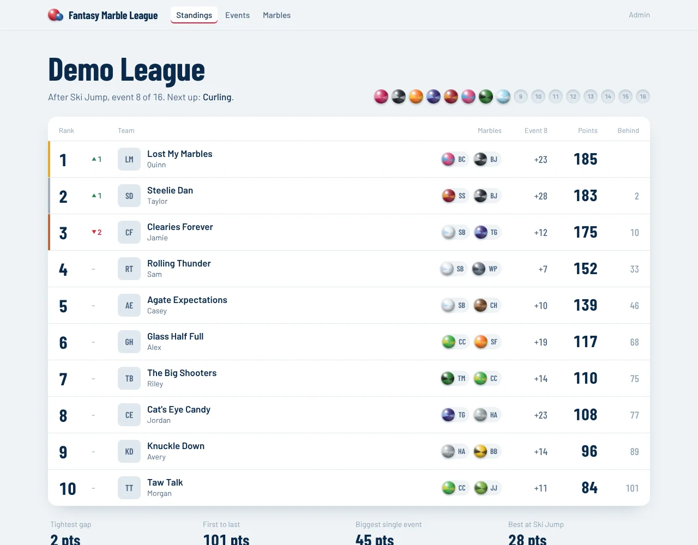

# FML: Fantasy Marble League

A small web app for running a fantasy league on top of Jelle's Marble Runs' Marble League. Each league team drafts marble teams into slots, scores whatever its marbles score in each event, and can trade a slot from any event onward.

It runs as one container with a SQLite database in a volume, and everything is managed from a password-protected admin area.



## AI DISCLOSURE

THIS IS VIBE CODED. I DO NOT RECOMMEND ANYONE EXPOSE THIS TO THE INTERNET DIRECTLY. Put it behind an authentication page (for example Cloudflare Access) if anyone outside your network needs to see it.

Although this is publicly listed, this is for my personal use. Given that this is vibe coded and it's for my personal use, I make no promises things will be fixed. All that said it works pretty well for me and my league.

FML is a fan project and isn't affiliated with or endorsed by Jelle's Marble Runs.

## Install

```yaml
services:
  fml:
    image: ghcr.io/nathanapples/fml:latest
    container_name: fml
    environment:
      - PUID=1000
      - PGID=1000
      - TZ=Etc/UTC
      - ADMIN_PASSWORD=change-me
      # - PUBLIC_URL=https://fml.example.com   # your address, for single sign-on
      # Single sign-on can be set up in Admin, Users and sign-in, or here:
      # - AUTH_MODE=oidc   # set to password to get back in if sign-on breaks
      # - OIDC_ISSUER=https://id.example.com
      # - OIDC_CLIENT_ID=
      # - OIDC_CLIENT_SECRET=
      # - OIDC_ADMIN_GROUP=fml-admins
      # - SEED=false   # start with an empty league instead of the demo
    volumes:
      - ./config:/config
    ports:
      - 5076:5076
    restart: unless-stopped
```

Paste that into a new Dockge stack (or `docker compose up -d`), change `ADMIN_PASSWORD`, and open `http://<host>:5076`.

The first start loads a made-up demo league so there's something to look at. Set `SEED=false` to start empty, or delete the demo season under Admin, Seasons and backup once your own league is in.

The image is built by GitHub Actions on every push to main and published to `ghcr.io/nathanapples/fml` for amd64 and arm64.

### Environment variables

| Variable | Purpose |
|---|---|
| `PUID` / `PGID` / `TZ` / `UMASK` | Container user, group, time zone, umask |
| `ADMIN_PASSWORD` | Password for `/admin` while single sign-on is off. Admin is off when it's unset and single sign-on is off |
| `PUBLIC_URL` | The address people use, like `https://fml.example.com`. Sets the sign-in callback URL; without it FML works it out from the request |
| `AUTH_MODE` | `oidc` or `password`. Overrides the switch in Admin. `password` is the way back in if single sign-on breaks |
| `OIDC_ISSUER` / `OIDC_CLIENT_ID` / `OIDC_CLIENT_SECRET` | Pocket ID (or any OIDC provider) settings. Optional: you can enter them in Admin instead |
| `OIDC_ADMIN_GROUP` | Members of this group become FML admins when they sign in |
| `OIDC_INTERNAL_URL` | Where FML reaches the provider from inside Docker, if not the issuer URL |
| `OIDC_LABEL` | The name on the sign-in button. Defaults to Pocket ID |
| `LOG_RECOVERY_LINK` | `false` hides the "Can't sign in?" button, which writes a one-time admin link to the container log |
| `SESSION_SECRET` | Signs sign-in cookies. Generated and kept in the database when unset |
| `SEED` | `false` skips loading the demo league into an empty database |
| `COOKIE_SECURE` | `true` if you serve FML only over HTTPS |

Everything FML keeps lives in `/config`: `fml.db` and the `flags/` folder.

The public pages are read-only and never need a sign-in. If you serve it over HTTPS, set `COOKIE_SECURE=true`.

### Users and single sign-on

Out of the box, the admin password opens `/admin` and there are no user accounts. To give everyone in the league an account, use [Pocket ID](https://pocket-id.org) or another OIDC provider:

1. In Pocket ID, add an OIDC client for FML. The callback URL is `https://<your FML address>/auth/oidc/callback` (Admin, Users and sign-in shows the exact one).
2. In FML, sign in with the admin password, open Admin, Users and sign-in, and fill in the issuer URL, client ID and secret. Put yourself in an admin group in Pocket ID and enter its name, so you're an admin when you sign in.
3. Press Check connection, tick Use single sign-on, and save.

From then on the sign-in page only offers Pocket ID, like Shelfhelp. Anyone Pocket ID lets in gets an account the first time they sign in, is linked to the player with the same name if there is one, and can change their name or pick their player under My account in the menu. Admins can promote people, link them to players or remove accounts on the same Admin page.

If single sign-on ever breaks, press "Can't sign in?" on the sign-in page: FML writes a one-time admin link, good for 15 minutes, to the container log (`docker logs fml`, or the stack's log in Dockge). Or set `AUTH_MODE=password` to bring the admin password back.

Backups never include the sign-in settings or secrets, and restoring one keeps everyone's accounts and links them back to their players by name.

## Using it

- **Fantasy Teams** (`/`): the leaderboard, season progress, the race chart (total points or league position), and the latest podium.
- **Events** (`/events`): every event and a results grid; each event has its own page with the finishing order and each league team's haul.
- **Marble Teams** (`/marbles`): the real marble teams' standings, medals and which fantasy teams have each one, with a page per marble team.
- **Team pages** (`/teams/:id`): slots, trade history and an event-by-event breakdown.
- **Players** (`/players`): the people behind the fantasy teams, with each player's teams, finishes and titles across every season.
- **My account** (menu): change your name and pick which player you are, once single sign-on is on.
- **Admin** (`/admin`):
  - *Results*: tap marble teams in finishing order. Points come from the season's points table (25, 20, 15, 12 … 0 by default) and any of them can be edited.
  - *Events*: names, dates, wiki and video links, and whether each event counts toward league standings (untick it for races held before your draft).
  - *League teams*: names, managers, flags, draft order, picks and trades. A trade is "this slot holds this marble from event N".
  - *Marble teams*: colours (the marble is drawn from these), optional logo, wiki link, and which teams are competing this season.
  - *Players*: rename players, add new ones, or merge duplicates. A fantasy team's Player field links it to a player; typing a new name creates one.
  - *Users and sign-in*: single sign-on settings and everyone's accounts.
  - *Seasons and backup*: start a new season (optionally carrying over marble teams and managers), change the points table, download a full JSON backup, or restore one.

## How scoring works

Events marked as not counting give every league team 0 points. For every other event, a slot is held by the pick with the highest `startEvent` that is less than or equal to the event number. The slot earns that marble team's points for the event. A league team's event total is the sum of its slots; positions use competition ranking, so ties share a place.

## Development

```bash
npm install
ADMIN_PASSWORD=dev npm run dev
```

Data goes to `./data`.

## Bringing in an existing league

Admin, Seasons and backup, Restore accepts either a full FML backup (replaces everything, flags included) or a single season file in the format of [`seed/season-demo.json`](seed/season-demo.json), which is added alongside your other seasons. A season file can carry its own flag images in a `flagFiles` map of `league/<year>/<name>.webp` to base64 image data.

## Credits

Built with Next.js, React, Tailwind CSS, Recharts and better-sqlite3. Marble League, its teams and its events belong to [Jelle's Marble Runs](https://jellesmarbleruns.com/).

## License

[GNU GPLv3](LICENSE)
